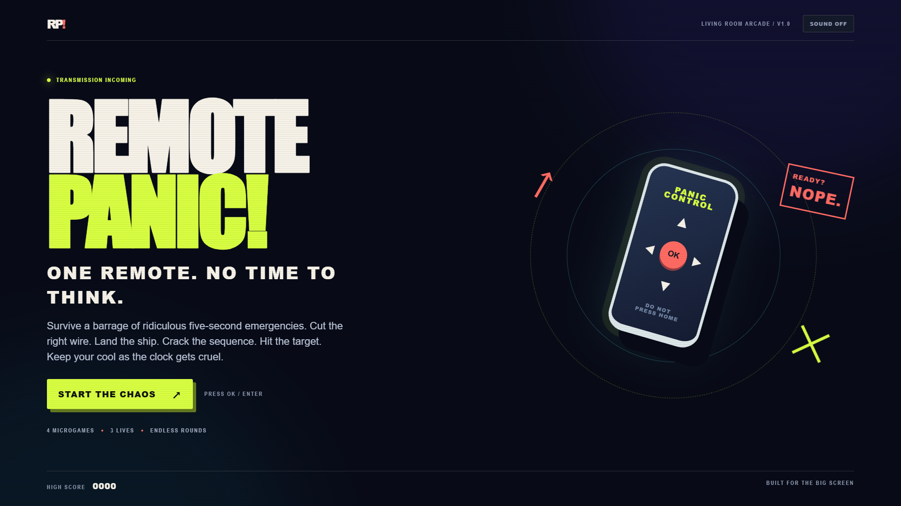
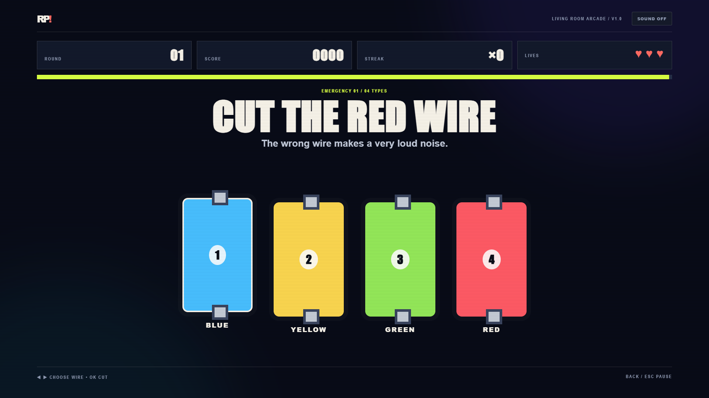

# Remote Panic!

**One remote. No time to think.** Remote Panic is a fast, full-screen microgame arcade built for LG webOS TV. Survive a series of short emergencies with only the directional pad and OK button. Each clear earns points; each mistake costs a life; each new round shortens the clock.



## At a glance

- **Four microgames:** cut the named wire, land a drifting UFO, enter a signal sequence, and time a target lock.
- **Arcade loop:** three lives, escalating speed, streak bonuses, and a saved personal best.
- **TV-first controls:** directional pad, OK, and Back. Keyboard equivalents make development and browser play easy.
- **Self-contained:** no account, backend, analytics, remote assets, or network requests during play.
- **LG package metadata:** includes the required webOS `appinfo.json` and launcher icons.



## Play in a browser

Open `index.html` directly, or run a local static server:

```powershell
npm install
npm run serve
```

Then visit `http://localhost:4173`.

| Action                              | LG remote       | Keyboard       |
| ----------------------------------- | --------------- | -------------- |
| Navigate / steer / enter a sequence | Directional pad | Arrow keys     |
| Select / cut / land / fire          | OK              | Enter or Space |
| Pause / resume                      | Back            | Escape         |

Sound starts off and can be toggled from the title screen. The best score and sound preference are stored locally on the TV or browser.

## Install on an LG webOS TV

This project is a **webOS web app**, not an Android APK. LG's [Developer Mode setup](https://webostv.developer.lge.com/develop/getting-started/developer-mode-app) requires an LG developer account, the **Developer Mode** app on the TV, and a PC on the same network. The exact menus and support depend on the TV's webOS version.

1. Install LG's [webOS CLI](https://webostv.developer.lge.com/develop/tools/cli-installation) on the PC:

   ```powershell
   npm install -g @webos-tools/cli
   ```

2. Enable Developer Mode on the TV, turn on its Key Server, and connect the CLI to the TV as described in [LG's guide](https://webostv.developer.lge.com/develop/getting-started/developer-mode-app). Keep the TV and PC on the same network.
3. From this repository, create an `.ipk` package. The script stages only the runtime files, excluding tests and development dependencies:

   ```powershell
   ./tools/package-webos.ps1
   ```

4. Install and launch the generated package, replacing `myTV` with the device name you configured in the CLI:

   ```powershell
   ares-install -d myTV ./com.fetachino.app.remotepanic_1.0.0_all.ipk
   ares-launch -d myTV com.fetachino.app.remotepanic
   ```

LG Developer Mode runs for a limited session. If it expires, LG says apps installed through Developer Mode are removed; reopen the Developer Mode app and extend the session before it runs out. See [LG's Developer Mode documentation](https://webostv.developer.lge.com/develop/getting-started/developer-mode-app).

## Development

```powershell
npm ci
npm test                 # deterministic gameplay-rule checks
npm run smoke            # end-to-end Chromium gameplay check
npm run format:check
```

The smoke test uses an installed Chrome on Windows or Playwright Chromium elsewhere (`npx playwright install chromium`). To refresh README screenshots, run `node tools/smoke.js --capture`.

The app has no runtime dependencies. `src/core.js` contains round generation and scoring; `src/game.js` owns the game state, remote input, audio, and rendering; `styles.css` contains the TV layout. `appinfo.json` and the generated PNGs in `assets/` are the webOS packaging files. The icon generator is `tools/make_icons.py` and requires Pillow only when regenerating icons.

## Verification status

| Check                                       | Result                                                                        |
| ------------------------------------------- | ----------------------------------------------------------------------------- |
| Gameplay-rule tests                         | Passed                                                                        |
| 1920 × 1080 Chromium smoke test             | Passed: title, first round, scoring, next round, pause/resume, no page errors |
| LG webOS `.ipk` packaging                   | Passed with LG's `ares-package` CLI                                           |
| Physical LG TV installation and remote play | **Pending**: exact TV model and Developer Mode connection needed              |

The browser screenshots are from a 1920 × 1080 Chromium run. They are not photographs of the app running on a physical TV. The first release is a playable prototype; additional microgames, TV performance tuning, and hardware testing are natural next steps.

## License

MIT. See [LICENSE](LICENSE).
